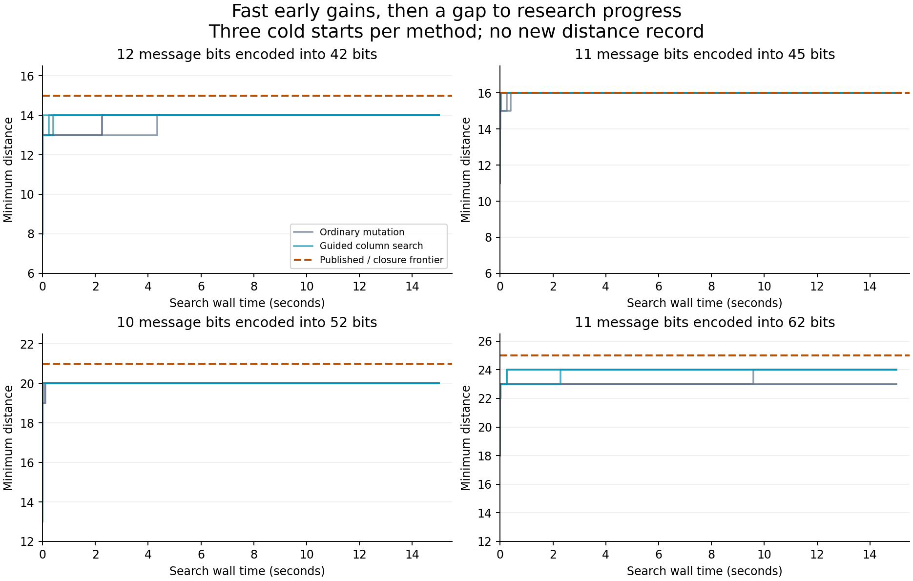

# Featured-pilot contributor trial

**Recommendation: keep this as a specialist pilot; do not lead the launch with the
current promise of fresh contributors improving best-known minimum distances.**
It has a compelling subject, inexpensive verification and a real role for agent
reasoning. The missing ingredient is demonstrated scientific progress that an
early contributor can reliably hill climb.

This was a **31.9-minute** LOCAL session, 18:57:48–19:29:40 UTC
on 20 October 2026, including orientation, implementation, experiments, checks and
assessment. It produced **91 search runs, zero new distance records**,
checked local obstructions, a portable recent-code replication and corrected donor
cards. This is a simulated contributor experience by the agent that already knew
the pilot, not an independent novice usability study.

## What the user would experience

Random starting codes improved quickly. In the initial comparison, ordinary
mutation gained a median 5 distance units and guided column search gained 5.5.
Each method recovered the known distance in 3 of 12 cold runs. The remaining
cases stopped short of the frontier. None of the 24 warm runs improved distance.
All 18 subsequent coset runs also retained their starting distance.



The figure includes all three cold seeds per method on each of four targets.
Its dashed line is the published/closure frontier. Gains below that line are
training or reconstruction progress. The flat distance at the line is not a
discovery, regardless of how many candidates were evaluated.

| Criterion | Assessment |
|---|---|
| Early scientific hill climbing | Weak for the stated distance objective: no frontier gain in this session. |
| Tangible first-session work | Good for algorithm improvements, reproducible constructions and ruling out bad search directions. |
| Public explanation | Strong premise: protect a message from flipped bits. Sustained public discovery progress remains unproven. |
| High-end home PC | Strong: one-thread search executables, no GPU or external solver; a million-word published code checked in about 33 seconds here. |
| Agent intelligence | Useful in reformulating searches and finding obstructions. Equal-CPU tests did not show a distance advantage. |
| Meaningful scientific potential | Credible field, but the current small-case frontier is a demanding launch target. |

## Measured search results

All lower bounds below include the pre-existing published-construction closure;
the upper bounds remain literature/analytic bounds, not newly replayed global
nonexistence proofs. These five cases are from the original sixteen-target
frontier. The other eleven were included in the local obstruction audit.

| Parameters | Closure lower | Best observed | Upper | Search runs |
|---|---:|---:|---:|---:|
| [42,12] | 15 | 15 | 16 | 22 |
| [44,11] | 16 | 16 | 17 | 9 |
| [45,11] | 16 | 16 | 18 | 16 |
| [52,10] | 21 | 21 | 22 | 22 |
| [62,11] | 25 | 25 | 26 | 22 |

The first comparison used 15 wall seconds per run: four cases, three seeds,
warm/cold starts and two methods, in shuffled order. Shared host load varied
substantially. We therefore added a separate held-out comparison with two new
seeds and **five CPU seconds per method per case**. It found **0/8 distance
wins, 8/8 distance ties**, and fewer minimum-weight words in all eight guided runs.
The median multiplicity improvement was **4.23×**.

| Parameters | Held-out seed | Distance: ordinary / guided | Minimum-word count: ordinary / guided |
|---|---:|---:|---:|
| [42,12] | 901 | 14 / 14 | 107 / 32 |
| [42,12] | 902 | 14 / 14 | 108 / 31 |
| [45,11] | 901 | 16 / 16 | 85 / 16 |
| [45,11] | 902 | 16 / 16 | 83 / 20 |
| [52,10] | 901 | 20 / 20 | 57 / 10 |
| [52,10] | 902 | 20 / 20 | 61 / 9 |
| [62,11] | 901 | 24 / 24 | 125 / 29 |
| [62,11] | 902 | 24 / 24 | 110 / 28 |

Fewer minimum words is a real, basis-independent property of a code, but it does
not increase its guaranteed minimum distance. We did not compare these spectra
against all published spectra. In particular, some reconstructed table recipes
choose an arbitrary subcode and are not optimized weight-enumerator baselines.

The secondary progress has a concrete interpretation under a different objective:
for one warm [45,11,16] witness, the minimum-word count fell from 247 to 18.
[Exact rational calculations](channel_metrics.json) give about 10.40× lower
undetected-error probability at independent bit-flip probability 0.05 than our
starting witness. This measures code-membership error detection, **not decoding
block-error probability**, and is neither a new distance record nor a claim of
the best known error-detection performance. It could motivate a separately
scoped project with proper baselines; it should not silently replace this task's
scientific objective.

| Phase | Runs | Search steps | CPU seconds | Search wall seconds |
|---|---:|---:|---:|---:|
| paired | 48 | 16,599,808 | 246.6 | 720.2 |
| heldout | 16 | 5,242,002 | 80.0 | 266.1 |
| coset | 18 | 55,740,548 | 120.0 | 270.0 |
| qc | 9 | 29,448,649 | 54.2 | 180.0 |

Search steps are not distinct inequivalent codes. A Walsh step scores all possible
columns through a transform; its alternative count is not a count of separately
verified complete codes. The recorded CPU total covers search executables only;
verification, compilation, agent inference and report work are separate.

## Where reasoning made a difference

1. **A complete two-column obstruction audit.** All 20,854 coordinate pairs over
   the sixteen starting matrices were excluded. There are 20,662 direct
   minimum-word witnesses, three odd linear dependencies, and 189 checks
   exhausting the permitted affine solutions. A separate checker uses direct
   string/vector arithmetic. This rules out improving those fixed matrices by
   replacing at most two columns; it does not rule out other codes.
2. **A donor task was mathematically impossible.** The original [45,14,16] QC
   parent has only weights divisible by four. An improved dimension-11 subcode
   would need distance at least 20. Griesmer requires length at least 46.
   Consequently every dimension-11 subcode of that parent has distance exactly
   16. We retired that search and tested a different four-circulant family.
3. **An improved search implementation.** Walsh transforms evaluate the
   exponential objective for every replacement column in O(k·2^k) work.
   Structured perturbations escape coordinate minima. This is a new application
   in this repository, not a claim of inventing a new mathematical transform.
4. **Adaptive repair and structure.** Exact three-column repair exhausted all
   14,190 coordinate triples around one improved-spectrum [45,11,16] witness,
   examining 1,046,103 replacement-column pairs without a repair. This search
   result has no separate proof certificate and is labelled accordingly.
   Coset search preserved the even-weight kernel while moving the other coset.
   QC evaluation exploited cyclic message orbits: 187 representatives instead
   of 2,047 nonzero messages, checked against full enumeration.

These outcomes improve the project and save future contributors wasted effort.
They also expose that the original donor list was too optimistic: the initial
two-column and fixed-parent subspace directions should not have been advertised
as promising discovery tasks. The catalog now incorporates the obstructions.

## Larger-code control and resource limits

We reconstructed the published **[173,20,68]** construction from
[Seddas et al., Appendix A](https://arxiv.org/html/2609.37056v1#A1).
Both implementations checked all 1,048,576 codewords and agreed on distance 68
and 1,156 minimum words. It was already in the novelty exclusions, so this is
replication credit. The authors report 3–4-hour searches on an 80 GB H100;
our measurement covers verification of a supplied construction.

Here the Gray-code check took 0.62 wall seconds, the independently implemented
column-parity check 32.13 seconds, and construction plus checks 33.25 seconds
(15.63 CPU seconds). Peak RSS for that Python process was about 29.2 MiB.
The initial C++ search executables peaked at about 1.6 MiB RSS. Hardware:
Apple M2, eight logical CPUs, 24 GiB RAM, with substantial unrelated host load.
Search jobs used one thread and ran sequentially; some validation/repair work
overlapped. No GPU was used. These are measurements on one shared machine,
not a cross-platform benchmark.

A concrete zero-residue word also proves that adding more five-periodic tails
to this fixed 170-coordinate core cannot exceed distance 68. A seven-message odd
dependency proves that no arbitrary single-column extension of the published
173-coordinate matrix reaches 69. Both are small checked obstructions, not
global upper bounds on [174,20] codes.

## Public demo and a launch gate

Run the supplied demonstration:

```sh
python3 research/c0202026102018570000000000000001/demo.py
```

It encodes eleven message bits into 45 transmitted bits, flips seven selected
bits, and recovers the message by nearest-codeword decoding. The certificate is
checked first. Show the real progress chart beside it with the published
frontier always visible. Call early gains “learning to build a good code,” and
reserve “discovery” for an audited improvement beyond prior art.

One distance unit does not always add a guaranteed correctable error:
the radius is floor((d−1)/2). For example, 21→22 still guarantees correction
of ten arbitrary errors, whereas 16→17 increases seven to eight.

I would reconsider featured status after an expert-curated larger structured
frontier and several **independent first-hour contributor trials** produce
accepted progress beyond predeclared incumbent scientific or algorithmic
baselines. A proposed practical gate is at least three independent contributors,
with useful accepted outcomes and measured review burden, and at least two
improvements surviving equal-compute held-out evaluation. That is a product
decision criterion, not a statistical guarantee of future records.

For launch now, position this as a specialist mathematics/construction track.
An alternative featured project could explicitly optimize search algorithms,
verification efficiency or a defined reliability objective. Such a change
would need its own benchmark and novelty policy.

## Reproduction and evidence

Requirements: Python 3.10+ standard library and a C++17 compiler. Tested with
Python 3.14.6 and Apple clang on macOS. The timing runners support macOS/Linux
`/usr/bin/time`; Windows was not tested. Plot regeneration alone uses
matplotlib 3.10.7 in an optional isolated environment.

From the repository root:

```sh
python3 scripts/reproduce.py
python3 research/c0202026102018570000000000000001/build.py
python3 research/c0202026102018570000000000000001/replay.py
python3 research/c0202026102018570000000000000001/verify_certificates.py
python3 research/c0202026102018570000000000000001/verify_extra.py
```

Default replay checks six representative runs by exact iteration count and
compares matrices, scores and counters; `--all` replays all 91. Replaying counts
is deterministic in the tested environment; runtime varies. Floating-point
heuristics may take different paths on another compiler/platform, while the
integer generator certificates remain portable.

The original baseline reproduction still passes all sixteen targets, 66
certificates and seven test groups. The trial-wide check passed
**439 new saved certificates**, including every saved
distance milestone, all final search outputs, parity extensions and controls.
The exact Walsh energy formula passed 1,600 direct-enumeration comparisons;
affine solving passed 1,000 brute-force controls. Malformed local proofs were
rejected. Two verification implementations are not two independent reviewers.

- [Plan](PLAN.md), [decision log](DECISIONS.md), [machine-readable summary](summary.json),
  [session timing](session.json), [artifact hashes](artifact-index.json).
- [Two-column proofs](obstructions.json), [fixed QC family bound](qc_family_proof.json),
  [three-column search](repair_45_11.json).
- [Larger published-code control](large_control.json),
  [generator](published_173_20_68.json), [extension obstruction](large_extension.json).
- [Paired runs](paired/manifest.json), [equal-CPU held-out runs](heldout/manifest.json),
  [coset runs](coset/manifest.json), [QC runs](qc/manifest.json).
- [Certificate check](certificate_verification.json), [deterministic replay](replay/receipt.json),
  [exact secondary metric](channel_metrics.json).

All search outputs and unsuccessful runs are retained. No unrestricted
optimality proof, new scientific record, independent human review, publication
or maintainer consent is claimed. The small number of selected cases and one
adaptive agent session cannot estimate a general contributor discovery rate.
The project remains LOCAL and donor recruitment remains paused.

```discover
{"v":0,"kind":"done","task":"featured-pilot-contributor-trial","scope":"LOCAL timed binary-code contributor trial; no new distance record; scoped obstructions, recent-code replication, revised donor tasks and launch assessment","base":"f7e33cc1680b7e31f5f167f8320bab535d2c0515","posted_at":"2026-10-20T19:29:40.419365Z","evidence_level":"local-only","artifact":"research/c0202026102018570000000000000001/README.md"}
```
